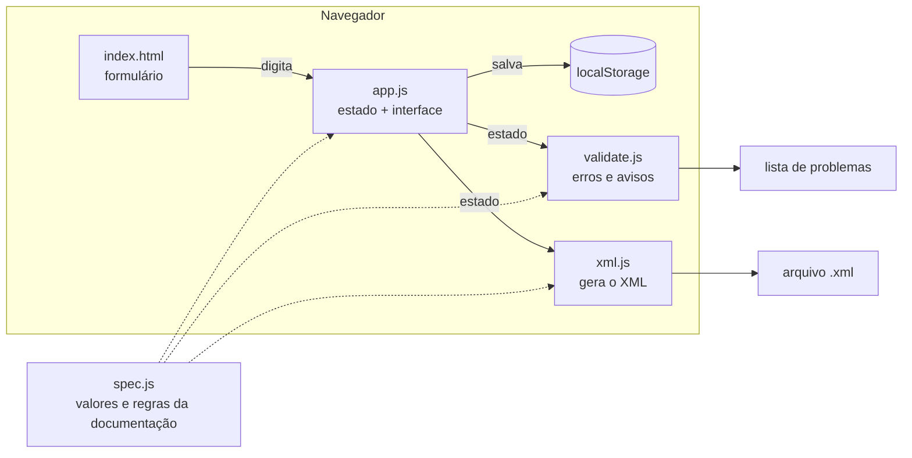

<div align="center">

# 🏠 Gerador de XML VRSync

**Preencha um formulário. Receba o XML pronto para o Grupo OLX.**

Um gerador de feeds no padrão **VRSync**, o formato de integração de imóveis usado pelo<br>
**ZAP Imóveis · VivaReal · Canal Pro** (Grupo OLX).


[Começar](#-começando) · [Tour pelo formulário](#-tour-pelo-formulário) · [Validação](#-validação) · [Referência](#-referência-dos-valores-aceitos) · [Como funciona por dentro](#-como-funciona-por-dentro) · [FAQ](#-perguntas-frequentes)

</div>

---

## 📑 Índice

- [O que é isso?](#-o-que-é-isso)
- [Começando](#-começando)
- [Tour pelo formulário](#-tour-pelo-formulário)
- [O XML que sai do outro lado](#-o-xml-que-sai-do-outro-lado)
- [Validação](#-validação)
- [Referência dos valores aceitos](#-referência-dos-valores-aceitos)
- [Como funciona por dentro](#-como-funciona-por-dentro)
- [Estendendo o projeto](#-estendendo-o-projeto)
- [Privacidade](#-privacidade)
- [Limitações e decisões de projeto](#-limitações-e-decisões-de-projeto)
- [Perguntas frequentes](#-perguntas-frequentes)
- [Aviso legal](#-aviso-legal)

---

## 🧭 O que é isso?

Quem anuncia imóveis nos portais do **Grupo OLX** (ZAP Imóveis, VivaReal e o painel **Canal Pro**) pode enviar o catálogo de uma vez, em vez de cadastrar imóvel por imóvel. Para isso, entrega um arquivo **XML** num formato específico chamado **VRSync**, descrito na [documentação oficial](https://developers.grupozap.com/feeds/vrsync/).

Escrever esse XML à mão é trabalhoso e fácil de errar: são dezenas de elementos, valores em inglês que precisam ser exatos (`Residential / Apartment`, `For Sale`, `Sale/Rent`…), regras de obrigatoriedade que mudam conforme o tipo de imóvel e limites que fazem o portal recusar o anúncio.

**Este projeto resolve isso com um formulário:**

| Você faz | A ferramenta faz |
| --- | --- |
| Escolhe o tipo de imóvel numa lista | Escreve o valor exato que o portal espera |
| Digita preços como quiser | Envia só o número inteiro, sem `R$`, ponto ou vírgula |
| Preenche o que sabe | Avisa o que falta, antes de você enviar |
| Cola as URLs das fotos | Monta a seção `Media` na ordem certa, com a foto de destaque |
| Clica em **Gerar** | Entrega o XML formatado, com o encoding e o CDATA corretos |

> [!NOTE]
> O formulário cobre **tudo o que a documentação VRSync descreve**: cabeçalho, imobiliária, todos os tipos de transação e publicação, os 24 tipos de imóvel, as 186 características, garantias de locação, mídia (fotos, vídeo e vídeo curto), localização nas três formas de exibição, tour virtual, IPTU, condomínio e mais.

---

## 🚀 Começando

Não há nada para instalar. O projeto é um site estático (HTML, CSS e JavaScript puros).

### Opção 1 — Abrir direto no navegador

1. Baixe ou clone o repositório:
   ```bash
   git clone https://github.com/theowari/Criador-de-XML-Padr-o-VRSync.git
   ```
2. Dê dois cliques em **`index.html`**.

Pronto. Foi testado no Chrome e deve funcionar em qualquer navegador moderno. Depois de baixado, funciona até sem internet.

### Opção 2 — Servidor local (opcional)

Alternativa se você preferir rodar em `http://localhost`, ou se o seu navegador restringir o armazenamento local em arquivos abertos direto do disco:

```bash
# com Python
python -m http.server 8000

# ou com Node
npx serve .
```

Depois abra <http://localhost:8000>.

### Opção 3 — Publicar na internet com o GitHub Pages

Por ser um site estático, ele roda de graça no GitHub Pages:

1. No repositório, vá em **Settings → Pages**.
2. Em **Build and deployment**, escolha **Deploy from a branch**.
3. Selecione a branch **`main`** e a pasta **`/ (root)`** e clique em **Save**.
4. Em alguns minutos, o site estará em
   `https://<seu-usuario>.github.io/<nome-do-repositorio>/`.

> [!TIP]
> Qualquer hospedagem de arquivos estáticos serve (Netlify, Vercel, Cloudflare Pages, um bucket S3…). Basta publicar a pasta inteira.

### Os 4 passos de uso

```text
┌──────────────┐   ┌──────────────┐   ┌──────────────┐   ┌──────────────┐
│ 1. Cabeçalho │ → │ 2. Imobiliá- │ → │ 3. Imóveis   │ → │ 4. Gerar     │
│   e arquivo  │   │    ria       │   │ (um ou mais) │   │    o XML     │
└──────────────┘   └──────────────┘   └──────────────┘   └──────────────┘
```

1. Configure o arquivo e preencha o cabeçalho.
2. Preencha os dados da imobiliária (uma vez só).
3. Cadastre os imóveis, quantos precisar.
4. Clique em **Validar e gerar XML**. Corrija o que a lista apontar, depois **copie** o XML ou **baixe** o arquivo `.xml`.

O arquivo baixado é o que você envia ao portal (veja a documentação de [conexão e integração](https://developers.grupozap.com/feeds/integration.html)).

---

## 📋 Tour pelo formulário

O formulário tem cinco seções. Os campos obrigatórios aparecem com um asterisco vermelho no formulário e com ✅ nas tabelas abaixo. Ao lado de cada campo do formulário aparece o nome do **elemento XML** correspondente, para você relacionar o que preenche com o que sai no arquivo.

### 1. Arquivo

Opções que afetam o XML inteiro.

| Opção | O que faz |
| --- | --- |
| **Encoding** | `UTF-8` (padrão) ou `ISO8859-1`, os dois únicos aceitos pelo portal. Em ISO8859-1, caracteres fora do alfabeto latino (como emojis) viram referências numéricas (`&#128512;`) para não corromper o arquivo. |
| **CDATA nos textos** | Envolve cidade, bairro, endereço, nomes etc. em `<![CDATA[…]]>`. É a recomendação da documentação para evitar que acentos fiquem quebrados (`Espírito Santo`). `Title` e `Description` sempre vão em CDATA. |
| **Enter vira `<br>`** | Converte as quebras de linha da descrição em `&lt;br&gt;`, a forma que o portal entende. |
| **`Garage type="Parking Space"`** | Inclui o atributo `type` na garagem, como nos exemplos completos da documentação. |

### 2. Cabeçalho (`Header`)

Identifica quem desenvolveu/gerou o arquivo.

| Campo | Elemento XML | Observação |
| --- | --- | --- |
| Desenvolvedor do feed | `Provider` | Nome de quem gera o arquivo |
| E-mail | `Email` | |
| Nome do cliente | `ContactName` | |
| Telefone | `Telephone` | |
| Data de publicação | `PublishDate` | Por padrão usa a data/hora do momento da geração, no formato `2026-10-11T11:48:18` |

### 3. Imobiliária (`ContactInfo`)

Os dados de contato do anunciante. Você preenche **uma vez** e ele vai em todos os imóveis (a menos que um imóvel tenha contato próprio).

| Campo | Elemento XML | Obrigatório |
| --- | --- | :---: |
| Nome da imobiliária | `Name` | ✅ |
| E-mail da imobiliária | `Email` | ✅ |
| Website | `Website` | |
| URL do logo | `Logo` | |
| Nome da agência/filial | `OfficeName` | |
| Telefone | `Telephone` | |
| Endereço (País, UF, Cidade, Bairro, Endereço, CEP) | `Location` | |

> A documentação avisa: sem as informações mínimas de contato (`Name` e `Email`), ocorrem erros de importação.

### 4. Imóveis (`Listings`)

Aqui fica o coração do formulário. Use o seletor no topo para alternar entre imóveis, e os botões **Novo imóvel**, **Duplicar** e **Remover**. Duplicar copia todos os campos e acrescenta `-COPIA` ao código, útil para cadastrar unidades parecidas.

#### 4.1 Identificação

| Campo | Elemento XML | Regra da documentação |
| --- | --- | --- |
| Código do anúncio ✅ | `ListingID` | 1 a 50 caracteres e **único** no arquivo. É o código que você vê no Canal Pro. |
| Título ✅ | `Title` | 10 a 100 caracteres, sem HTML |
| Tipo de transação ✅ | `TransactionType` | Venda, aluguel ou os dois (veja a [tabela](#transações)) |
| Tipo de publicação | `PublicationType` | Padrão, destaque, super destaque, premiere… (veja a [tabela](#tipos-de-publicação)) |
| URL do anúncio no seu site | `DetailViewUrl` | |
| Tour virtual | `VirtualTourLink` | Página só com o tour, em **https**, com certificado válido e **sem link encurtado** |

#### 4.2 Fotos e vídeos (`Media`)

Uma tabela editável onde cada linha é uma mídia (`Item`). Você pode adicionar uma a uma, ou **colar várias URLs de uma vez**, uma por linha. A ferramenta tenta reconhecer sozinha se é foto, vídeo do YouTube (`youtube.com`/`youtu.be`) ou vídeo curto (`.mp4`/`.mov`); você pode corrigir o tipo na tabela. Os botões **↑ ↓ ✕** reordenam e removem. A primeira foto adicionada já vem como destaque.

| Tipo (`medium`) | Para quê | Regras da documentação |
| --- | --- | --- |
| `image` | Fotos | Somente **.jpg**, até **7 MB**, **mínimo de 5** por anúncio, apenas **uma** com `primary="true"` (a de destaque). As demais aparecem na ordem em que forem enviadas. |
| `video` | Vídeo do imóvel | Somente **YouTube**, **um** por imóvel |
| `reel` | Vídeo curto vertical | **.mp4** ou **.mov**, até 80 MB, 10 a 60 s, orientação vertical 9:16, **um** por imóvel. Não aceita links de YouTube, Instagram ou TikTok. |

> [!IMPORTANT]
> O portal usa a **URL da imagem como identificador**. Na primeira vez que ela aparece, a foto é baixada e guardada. **Se você trocar a foto, troque também a URL**, senão o portal continua usando a antiga.

#### 4.3 Características (`Details`)

| Campo | Elemento XML | Observação |
| --- | --- | --- |
| Finalidade | `UsageType` | Residencial, Comercial ou os dois |
| Tipo de imóvel ✅ | `PropertyType` | Ao escolher, o formulário mostra o nome equivalente no **VivaReal** e no **ZAP**, qual área é exigida e se há recomendação de complemento |
| Descrição ✅ | `Description` | 50 a 3.000 caracteres, sem tags HTML. Há botões para **quebra de linha, negrito, itálico e marcador •** (veja [formatação da descrição](#formatação-da-descrição)). Um contador mostra o tamanho. |
| Valor de venda | `ListPrice` | Só aparece em venda ou venda/aluguel |
| Valor do aluguel | `RentalPrice` | Só aparece em aluguel ou venda/aluguel |
| Período do aluguel | `RentalPrice@period` | Mensal, diário, semanal, trimestral ou anual |
| Condomínio | `PropertyAdministrationFee` | `0` significa **isento** |
| IPTU | `Iptu` | O campo antigo `YearlyTax` está em desuso (veja [decisões](#-limitações-e-decisões-de-projeto)) |
| Período do IPTU | `Iptu@period` | Anual (padrão) ou mensal |
| Área útil | `LivingArea` | Em m², número inteiro |
| Área total | `LotArea` | Em m², número inteiro |
| Quartos | `Bedrooms` | Obrigatoriedade depende do tipo de imóvel |
| Banheiros | `Bathrooms` | Obrigatoriedade depende do tipo de imóvel |
| Suítes | `Suites` | |
| Vagas de garagem | `Garage` | |
| Andares da torre | `Floors` | Ex.: um prédio de 13 andares → `13` |
| Andar do imóvel | `UnitFloor` | Ex.: terceiro andar → `3` |
| Torres do condomínio | `Buildings` | |
| Ano de construção | `YearBuilt` | 4 dígitos |
| Características | `Features` | 186 opções da tabela oficial, com **busca** e contador. Dá para adicionar um valor livre. |
| Garantias de locação | `Warranties` | Aparece só quando a transação inclui aluguel |

O formulário **se adapta** ao que você escolhe:

- Escolheu **venda**? O campo de aluguel e as garantias desaparecem. Escolheu **aluguel**? Some o valor de venda.
- Escolheu **Kitnet**? O campo de quartos trava em `0`, como manda a documentação.
- O asterisco de obrigatório em **quartos**, **banheiros**, **área útil** e **área total** aparece ou some conforme o tipo de imóvel.
- Escolheu estado **DF**? Aparece uma dica sobre como o Grupo OLX reconhece cidades-satélite de Brasília.

#### 4.4 Localização (`Location`)

| Campo | Elemento XML | Observação |
| --- | --- | --- |
| O que exibir do endereço ✅ | `displayAddress` | Veja as 3 opções [abaixo](#exibição-do-endereço) |
| País e sigla ✅ | `Country` + `abbreviation` | Já vem `Brasil` / `BR` |
| Estado (UF) ✅ | `State` + `abbreviation` | Lista com as 27 UFs; o nome por extenso é preenchido sozinho |
| Cidade ✅ | `City` | |
| Zona | `Zone` | Diferencia bairros homônimos (ex.: Vila Califórnia, na Zona Sul e na Zona Leste de São Paulo) |
| Bairro ✅ | `Neighborhood` | |
| Logradouro | `Address` | |
| Número | `StreetNumber` | |
| Complemento | `Complement` | **Não aparece nos portais.** Recomendado para apartamento, flat, cobertura, kitnet, loft e casa de condomínio. |
| CEP ✅ | `PostalCode` | Obrigatório em todos os anúncios |
| Latitude / Longitude | `Latitude` / `Longitude` | Use ponto como separador decimal |

#### 4.5 Contato do imóvel

Marque **"Usar um contato diferente"** se este imóvel deve aparecer com outro contato que não o da seção 3 (por exemplo, um corretor específico). Os mesmos campos da imobiliária ficam disponíveis.

### 5. Gerar XML

| Botão | O que faz |
| --- | --- |
| **Validar e gerar XML** | Roda a [validação](#-validação), mostra erros e avisos e escreve o XML na caixa de texto |
| **Copiar XML** | Copia o resultado para a área de transferência |
| **Baixar arquivo .xml** | Baixa `vrsync-AAAAMMDD-HHMMSS.xml` já no encoding escolhido |

Cada erro ou aviso da lista é **clicável**: o formulário abre o imóvel e leva você direto ao campo com problema.

### Salvar, exportar e importar

- **Salvamento automático:** tudo o que você digita é guardado no navegador. Pode fechar a aba e voltar depois.
- **Exportar projeto (.json):** baixa tudo (configurações, cabeçalho, imobiliária e todos os imóveis) num arquivo. Use para fazer backup ou levar o trabalho para outro computador.
- **Importar projeto (.json):** carrega um arquivo exportado antes.
- **Novo projeto:** apaga tudo e recomeça (pede confirmação).

---

## 📄 O XML que sai do outro lado

Este é um exemplo **real**, gerado pela ferramenta a partir de uma kitnet para aluguel:

```xml
<?xml version="1.0" encoding="UTF-8"?>
<ListingDataFeed xmlns="http://www.vivareal.com/schemas/1.0/VRSync"
                 xmlns:xsi="http://www.w3.org/2001/XMLSchema-instance"
                 xsi:schemaLocation="http://www.vivareal.com/schemas/1.0/VRSync http://xml.vivareal.com/vrsync.xsd">
  <Header>
    <Provider><![CDATA[Dev Feed]]></Provider>
    <Email>dev@feed.com</Email>
    <ContactName><![CDATA[Cliente]]></ContactName>
    <PublishDate>2026-10-11T11:48:18</PublishDate>
    <Telephone>11 9999-9999</Telephone>
  </Header>
  <Listings>
    <Listing>
      <ListingID>IMOVEL-001</ListingID>
      <Title><![CDATA[Apartamento lindo em São Paulo]]></Title>
      <TransactionType>For Rent</TransactionType>
      <PublicationType>STANDARD</PublicationType>
      <Media>
        <Item medium="image" primary="true">https://site.com/f1.jpg</Item>
        <Item medium="image">https://site.com/f2.jpg</Item>
        <Item medium="image">https://site.com/f3.jpg</Item>
        <Item medium="image">https://site.com/f4.jpg</Item>
        <Item medium="image">https://site.com/f5.jpg</Item>
        <Item medium="video">https://youtu.be/abc</Item>
      </Media>
      <Details>
        <UsageType>Residential</UsageType>
        <PropertyType>Residential / Kitnet</PropertyType>
        <Description><![CDATA[Kitnet mobiliada perto do metrô.&lt;br&gt;
Ambiente integrado, ótima iluminação e condomínio com portaria 24h.]]></Description>
        <RentalPrice currency="BRL" period="Weekly">2800</RentalPrice>
        <LivingArea unit="square metres">30</LivingArea>
        <Bedrooms>0</Bedrooms>
        <Bathrooms>1</Bathrooms>
        <Features>
          <Feature>Furnished</Feature>
        </Features>
        <Warranties>
          <Warranty>GUARANTOR</Warranty>
        </Warranties>
      </Details>
      <Location displayAddress="All">
        <Country abbreviation="BR"><![CDATA[Brasil]]></Country>
        <State abbreviation="SP"><![CDATA[São Paulo]]></State>
        <City><![CDATA[São Paulo]]></City>
        <Neighborhood><![CDATA[Centro]]></Neighborhood>
        <Address><![CDATA[Rua X]]></Address>
        <StreetNumber><![CDATA[10]]></StreetNumber>
        <Complement><![CDATA[apto 1]]></Complement>
        <PostalCode>01000-000</PostalCode>
      </Location>
      <ContactInfo>
        <Name><![CDATA[Imobiliária Teste]]></Name>
        <Email>contato@teste.com.br</Email>
      </ContactInfo>
    </Listing>
  </Listings>
</ListingDataFeed>
```

### O que a ferramenta cuida por você

| Regra da documentação | Como a ferramenta aplica |
| --- | --- |
| **Preços e áreas só com número inteiro**, sem `R$`, ponto, vírgula ou casas decimais | O campo aceita só números e a geração descarta casas decimais. `R$ 560.000,00` nunca é enviado. |
| **`currency="BRL"` obrigatório** nos valores | Sempre incluído em `ListPrice`, `RentalPrice`, `PropertyAdministrationFee` e `Iptu` |
| **`unit="square metres"` obrigatório** nas áreas | Sempre incluído em `LivingArea` e `LotArea` |
| **`ListPrice` só em venda, `RentalPrice` só em aluguel**, os dois em venda/aluguel | O XML só inclui o que a transação pede, mesmo que você tenha preenchido o outro campo antes |
| **Elemento vazio causa erro** (`<Description/>`) | Campos em branco simplesmente **não** vão para o XML |
| **Caracteres especiais** podem quebrar a importação | CDATA nos textos. Se o texto contiver `]]>`, a seção CDATA é dividida para não fechar antes da hora. `&`, `<` e `>` em campos sem CDATA são escapados. |
| **Encoding** `UTF-8` ou `ISO8859-1` | Os bytes do arquivo baixado correspondem ao encoding declarado na primeira linha |
| **Ordem dos elementos** | Segue a dos exemplos completos da documentação |

### Formatação da descrição

A documentação permite formatação básica na descrição, desde que escrita como **entidades HTML** (nunca como tags). Os botões acima do campo inserem isso para você:

| Efeito | O que vai no XML |
| --- | --- |
| Quebra de linha | `&lt;br&gt;` |
| **Negrito** | `&lt;b&gt;texto&lt;/b&gt;` |
| *Itálico* | `&lt;i&gt;texto&lt;/i&gt;` |
| Marcador • | `&bull;` |

Se a opção **"Enter vira `<br>`"** estiver ligada, cada Enter que você der no campo também vira uma quebra de linha.

### Exibição do endereço

O atributo `displayAddress` controla **quanto do endereço o portal mostra** ao público. Independente da escolha, a documentação recomenda **sempre enviar o endereço completo**, porque isso melhora o posicionamento nas buscas e a exibição no mapa.

| Valor de `displayAddress` | O que o portal exibe |
| --- | --- |
| `All` | Endereço completo (logradouro e número) |
| `Street` | Somente o logradouro (sem número) |
| `Neighborhood` | Somente o bairro |

---

## ✅ Validação

Antes de gerar, a ferramenta confere o que você preencheu e separa os problemas em dois níveis:

| Nível | Significado |
| --- | --- |
| 🔴 **Erro** | O portal deve **recusar** o anúncio (ou o arquivo). Corrija antes de enviar. |
| 🟡 **Aviso** | Não derruba o anúncio, mas a documentação **recomenda** corrigir, ou o resultado pode não ser o esperado. |

O XML é gerado de qualquer forma, mesmo com erros, para você poder inspecioná-lo.

### Regras que vêm da documentação

<details>
<summary><b>🔴 Erros (clique para expandir)</b></summary>

<br>

| Área | Regra |
| --- | --- |
| **Arquivo** | Pelo menos 1 imóvel; no máximo **50.000** anúncios por arquivo; `ListingID` não pode se repetir |
| **ListingID** | Entre 1 e 50 caracteres |
| **Title** | Entre 10 e 100 caracteres; sem tags HTML |
| **Transação** | `TransactionType` informado |
| **Tour virtual** | URL válida, em **https** e **não encurtada** (bit.ly, goo.gl, tinyurl etc.) |
| **Mídia** | Obrigatória; **mínimo de 5 imagens**; no máximo **1** foto de destaque; no máximo **1 vídeo** e **1 reel**; vídeo precisa ser do **YouTube**; reel não pode ser link de YouTube/Instagram/TikTok |
| **PropertyType** | Obrigatório |
| **Description** | Obrigatória; **50 a 3.000** caracteres; sem tags HTML (só as entidades de formatação) |
| **Preços** | `ListPrice` obrigatório em venda; `RentalPrice` obrigatório em aluguel |
| **Áreas** | `LivingArea` obrigatória para a maioria dos tipos; `LotArea` obrigatória para terrenos, galpões, fazendas, sítios e chácaras |
| **Quartos e banheiros** | Obrigatórios para os tipos indicados na [tabela de tipos](#tipos-de-imóvel); em **Kitnet**, `Bedrooms` deve ser `0` |
| **Localização** | `Country`, `State`, `City`, `Neighborhood`, `PostalCode` e `displayAddress` obrigatórios |
| **Contato** | `Name` e `Email` obrigatórios |

</details>

<details>
<summary><b>🟡 Avisos (clique para expandir)</b></summary>

<br>

| Área | Regra |
| --- | --- |
| **Header** | Campos do cabeçalho vazios (a documentação pede o cabeçalho completo) |
| **Mídia** | Imagem que não é `.jpg`; nenhuma foto marcada como destaque; reel que não é `.mp4`/`.mov` |
| **Tipo de imóvel** | Valor que só aparece nas tabelas de quartos/banheiros, mas não na tabela oficial de `PropertyType` |
| **Localização** | Sem logradouro (recomenda-se endereço completo); sem número (em breve será obrigatório para alguns tipos); sem complemento nos tipos em que ele é recomendado |
| **Garantias** | `Warranties` preenchidas em imóvel que não é de aluguel (não serão enviadas) |
| **Valores** | Valor com casas decimais (serão descartadas) |

</details>

### Verificações extras (bom senso, não vêm da documentação)

Para evitar enganos comuns, a ferramenta também confere: e-mail com formato válido, URLs bem formadas, valores negativos, número de suítes maior que o de quartos, andar do imóvel maior que o total de andares, ano de construção com 4 dígitos, faixa válida de latitude/longitude, formato do CEP (`00000-000`), URLs de mídia repetidas e latitude sem longitude (ou o contrário). Também avisa quando `UsageType` ou `PublicationType` não são informados, e exige áreas maiores que zero.

> [!WARNING]
> **Esta validação não substitui a do portal.** O arquivo de esquema oficial (`vrsync.xsd`) não é publicamente acessível, então a conferência é feita pelas regras escritas na documentação. Antes de colocar em produção, passe o arquivo pelo [Validador XML oficial](https://developers.grupozap.com/feeds/xml_validator/) e pelo [Relatório de Integração](https://developers.grupozap.com/feeds/report_integration_feeds.html) do Canal Pro.

---

## 📚 Referência dos valores aceitos

Todas as listas abaixo são geradas a partir de [`js/spec.js`](js/spec.js), o mesmo arquivo que alimenta o formulário. O que você vê aqui é exatamente o que a ferramenta aceita.

### Tipos de imóvel

Valores de `PropertyType`, com o nome equivalente em cada portal e as obrigatoriedades de cada tipo. **—** significa "não obrigatório" (ou "sem equivalente", nas colunas de portal).

| Valor no XML (`PropertyType`) | Filtro no VivaReal | Filtro no ZAP Imóveis | Área exigida | Quartos | Banheiros |
| --- | --- | --- | --- | --- | --- |
| `Residential / Apartment` | Apartamento | Apartamento | `LivingArea` (área útil) | obrigatório | obrigatório |
| `Residential / Home` | Casa | Casa | `LivingArea` (área útil) | obrigatório | obrigatório |
| `Residential / Condo` | Casa de Condomínio | Casa de Condomínio | `LivingArea` (área útil) | obrigatório | obrigatório |
| `Residential / Village House` | — | Casa de Vila | `LivingArea` (área útil) | obrigatório | obrigatório |
| `Residential / Farm Ranch` | Chácara | — | `LotArea` (área total) | obrigatório | obrigatório |
| `Residential / Penthouse` | Cobertura | Cobertura | `LivingArea` (área útil) | obrigatório | obrigatório |
| `Commercial / Consultorio` | Consultório | — | `LivingArea` (área útil) | — | obrigatório |
| `Commercial / Edificio Residencial` | Edifício Residencial | — | `LivingArea` (área útil) | obrigatório | obrigatório |
| `Residential / Agricultural` | Fazenda/Sítios/Chácaras | Fazenda / Sítio / Chácara | `LotArea` (área total) | obrigatório | obrigatório |
| `Residential / Flat` | Flat | Flat | `LivingArea` (área útil) | obrigatório | obrigatório |
| `Commercial / Industrial` | Galpão/Depósito/Armazém | Galpão / Depósito / Armazém | `LotArea` (área total) | — | — |
| `Commercial / Garage` | — | Garagem | `LivingArea` (área útil) | — | — |
| `Commercial / Hotel` | Hotel/Motel/Pousada | Hotel / Motel / Pousada | `LivingArea` (área útil) | — | — |
| `Commercial / Building` | Imóvel Comercial | — | `LivingArea` (área útil) | — | — |
| `Residential / Kitnet` | Kitnet/Conjugado | Kitnet | `LivingArea` (área útil) | 0 (fixo) | obrigatório |
| `Residential / Studio` | Apartamento | Studio | `LivingArea` (área útil) | obrigatório (mín. 0) | — |
| `Residential / Loft` | Apartamento | Loft | `LivingArea` (área útil) | obrigatório | obrigatório |
| `Commercial / Corporate Floor` | — | Andar / Laje Corporativa | `LivingArea` (área útil) | — | — |
| `Residential / Land Lot` | Lote/Terreno | Terreno / Lote / Condomínio | `LotArea` (área total) | — | — |
| `Commercial / Land Lot` | Lote/Terreno | Terreno / Lote / Condomínio | `LotArea` (área total) | — | — |
| `Commercial / Business` | Ponto Comercial/Loja/Box | Loja / Salão / Ponto Comercial | `LivingArea` (área útil) | — | — |
| `Commercial / Edificio Comercial` | Prédio/Edifício Inteiro | Prédio Inteiro | `LivingArea` (área útil) | — | — |
| `Commercial / Office` | Sala/Conjunto | Conjunto Comercial / Sala | `LivingArea` (área útil) | — | obrigatório |
| `Residential / Sobrado` | Sobrado | — | `LivingArea` (área útil) | obrigatório | obrigatório |

<details>
<summary>Dois valores extras que aparecem só nas tabelas de quartos e banheiros</summary>

<br>

A documentação cita estes valores nas tabelas de obrigatoriedade, mas **não** os lista na tabela oficial de `PropertyType`. Ficam disponíveis no formulário, mas geram um aviso.

| Valor | Área exigida | Quartos | Banheiros |
| --- | --- | --- | --- |
| `Commercial / Loja` | `LivingArea` (área útil) | — | obrigatório |
| `Commercial / Studio` | `LivingArea` (área útil) | obrigatório | — |

</details>

### Transações

Valores de `TransactionType`.

| Valor no XML | Significado |
| --- | --- |
| `For Sale` | Venda |
| `For Rent` | Aluguel |
| `Sale/Rent` | Venda e Aluguel |

Para aluguel diário, semanal ou em outro período que não o mensal, use `For Rent` e informe o período no `RentalPrice`.

### Tipos de publicação

Valores de `PublicationType`.

| Valor no XML | Significado |
| --- | --- |
| `STANDARD` | Padrão |
| `PREMIUM` | Destaque Padrão |
| `SUPER_PREMIUM` | Super destaque |
| `PREMIERE_1` | Destaque Exclusivo* (somente contratos Zap+) |
| `PREMIERE_2` | Destaque Superior* (somente contratos Zap+) |
| `TRIPLE` | Destaque Triplo* |

> Os destaques precisam respeitar a **grade contratada** e os anúncios não podem ter erros no Relatório de Integração. **Destaque Exclusivo** e **Superior** estão disponíveis apenas em contratos **Zap+**.

### Finalidade

Valores de `UsageType`.

| Valor no XML | Significado |
| --- | --- |
| `Residential` | Residencial |
| `Commercial` | Comercial |
| `Residential / Commercial` | Residencial e/ou Comercial |

### Período do aluguel

| Valor de `period` | Significado |
| --- | --- |
| `Monthly` | Mensal (padrão) |
| `Daily` | Diário |
| `Weekly` | Semanal |
| `Quarterly` | Trimestral |
| `Yearly` | Anual |

Sem o atributo `period`, o portal assume **mensal**. O elemento `RentalPrice` só pode aparecer **uma vez** por imóvel: se o imóvel é alugado por mês e por dia, escolha um dos períodos.

### Garantias de locação

| Valor no XML (`Warranty`) | Significado |
| --- | --- |
| `SECURITY_DEPOSIT` | Depósito de segurança (caução) |
| `GUARANTOR` | Fiador |
| `INSURANCE_GUARANTEE` | Garantia de seguro (seguro fiança) |
| `GUARANTEE_LETTER` | Carta de garantia |
| `CAPITALIZATION_BONDS` | Títulos de capitalização |

### Características (`Features`)

São **186** valores oficiais.

<details>
<summary><b>Ver as 186 características da tabela oficial</b></summary>

<br>

| Valor no XML (`Feature`) | Tradução |
| --- | --- |
| `Administration` | Administração |
| `Alarm System` | Sistema de alarme |
| `Armored Security Cabin` | Guarita blindada |
| `Backyard` | Quintal |
| `Balcony` | Varanda |
| `Bathtub` | Banheira |
| `Bar` | Bar |
| `Barbecue Balcony` | Churrasqueira na varanda |
| `BBQ` | Churrasqueira |
| `Beauty Room` | Espaço de beleza |
| `Bicycles Place` | Bicicletário |
| `Builtin Wardrobe` | Armário embutido |
| `Caretaker` | Zelador |
| `Caretaker House` | Casa de caseiro |
| `Cable Television` | TV a cabo |
| `Closet` | Closet |
| `Controlled Access` | Vigia |
| `Cooling` | Ar condicionado |
| `Copa` | Copa |
| `Digital Locker` | Fechadura digital |
| `Dinner Room` | Sala de jantar |
| `Eco Condominium` | Condomínio sustentável |
| `Eco Garbage Collector` | Coleta seletiva de lixo |
| `Edicule` | Edícula |
| `Electric Charger` | Carregador eletrônico para carro e bicicleta |
| `Elevator` | Elevador |
| `Fenced Yard` | Condomínio fechado |
| `Fireplace` | Lareira |
| `Fitness Room` | Espaço fitness |
| `Furnished` | Mobiliado |
| `Game room` | Salão de jogos |
| `Garden Area` | Jardim |
| `Geminada` | Geminada |
| `Generator` | Gerador elétrico |
| `Gourmet Area` | Espaço gourmet |
| `Gourmet Balcony` | Varanda gourmet |
| `Gourmet Kitchen` | Cozinha Gourmet |
| `Gravel` | Cascalho |
| `Green space / Park` | Espaço verde / Parque |
| `Gym` | Academia |
| `Heating` | Aquecimento |
| `Home Office` | Escritório |
| `Indoor Soccer` | Quadra de futebol |
| `Integrated Environments` | Ambientes integrados |
| `Intercom` | Interfone |
| `Internet Connection` | Conexão à internet |
| `Jogging track` | Pista de cooper |
| `Kitchen` | Cozinha |
| `Kitchen Cabinets` | Armário na cozinha |
| `Lake View` | Vista para lago |
| `Land` | Terra |
| `Large Kitchen` | Cozinha grande |
| `Large Window` | Janela grande |
| `Laundry` | Lavanderia |
| `Lawn` | Gramado |
| `Lunch Room` | Sala de almoço |
| `Maid's Quarters` | Área de serviço |
| `Media Room` | Cinema |
| `Meeting Room` | Sala de reunião |
| `Mezzanine` | Mezanino |
| `Mountain View` | Vista para a montanha |
| `Ocean View` | Vista para o mar |
| `Party Room` | Salão de Festas |
| `Patrol` | Ronda/Vigilância |
| `Paved Street` | Rua asfaltada |
| `Pay-per-use Services` | Serviço pay per use |
| `Pets Allowed` | Permite animais |
| `Pet Space` | Espaço Pet |
| `Playground` | Playground |
| `Pool` | Piscina |
| `Reception room` | Recepção |
| `Recreation Area` | Área de lazer |
| `Reflective Pool` | Espelhos d'água |
| `Sand Pit` | Quadra de areia |
| `Sauna` | Sauna |
| `Semi Olympic Pool` | Piscina semi-olímpica |
| `Smart Apartment` | Apartamento inteligente |
| `Smart Condominium` | Condomínio inteligente |
| `Solar Energy` | Energia solar |
| `Spa` | Spa |
| `Sports Court` | Quadra poliesportiva |
| `Square` | Praça |
| `Squash` | Quadra de squash |
| `Stair` | Escada |
| `Stores` | Loja |
| `Tennis court` | Quadra de tênis |
| `TV Security` | Circuito de segurança |
| `Valet Parking` | Manobrista |
| `Warehouse` | Depósito |
| `Water Tank` | Reservatório de água |
| `American Kitchen` | Cozinha americana |
| `Full Floor` | Andar inteiro |
| `Aquarium` | Aquário |
| `Bedroom Wardrobe` | Armário embutido no quarto |
| `Bathroom Cabinets` | Armário no banheiro |
| `Service Bathroom` | Banheiro de serviço |
| `Blindex Box` | Box blindex |
| `Carpet` | Capete |
| `Background House` | Casa de fundo |
| `Headquarters` | Casa sede |
| `Gas Shower` | Chuveiro a gás |
| `Burn Cement` | Cimento queimado |
| `Employee Dependency` | Dependência de empregados |
| `Pantry` | Despensa |
| `Drywall` | Drywall |
| `Cooker` | Fogão |
| `Pizza Oven` | Forno de pizza |
| `Freezer` | Freezer |
| `Sanca` | Gesso - Sanca - Teto Rebaixado |
| `Whirlpool` | Hidromassagem |
| `Corner Property` | Imóvel de esquina |
| `Soundproofing` | Isolamento acústico |
| `Thermal Insulation` | Isolamento térmico |
| `Aluminium Window` | Janela de alumínio |
| `Slab` | Laje |
| `Lavabo` | Lavabo |
| `Half Floor` | Meio andar |
| `Planned Furniture` | Móvel planejado |
| `Glass Wall` | Muro de vidro |
| `Walls Grids` | Muro e grade |
| `Hot Tub` | Ofurô |
| `High Ceiling Height` | Pé direito alto |
| `Private Pool` | Piscina privativa |
| `Wood Floor` | Piso de madeira |
| `Raised Floor` | Piso elevado |
| `Cold Floor` | Piso frio |
| `Laminated Floor` | Piso laminado |
| `Vinyl Floor` | Piso vinílico |
| `Platibanda` | Platibanda |
| `Porcelain` | Porcelanato |
| `Dividers` | Possui divisória |
| `Service Room` | Quarto de serviço |
| `Reversible Room` | Quarto extra reversível |
| `Large Room` | Sala grande |
| `Small Room` | Sala pequena |
| `Wall Balcony` | Varanda fechada com vidro |
| `Natural Ventilation` | Ventilação natural |
| `Panoramic View` | Vista panorâmica |
| `Disabled Access` | Acesso para deficientes |
| `Coworking` | Coworking |
| `Electronic Gate` | Portão eletrônico |
| `Fruit Trees` | Árvore frutífera |
| `Tree Climbing` | Arvorismo |
| `Library` | Biblioteca |
| `Toys Place` | Brinquedoteca |
| `Security Camera` | Câmera de segurança |
| `Dog Kennel` | Canil |
| `Barn` | Celeiro |
| `Beauty Center` | Centro de estética |
| `Fence` | Cerca |
| `Children Care` | Children care |
| `Coverage` | Cobertura coletiva |
| `Corral` | Curral |
| `Deck` | Deck |
| `Service Entrance` | Entrada de serviço |
| `Side Entrance` | Entrada lateral |
| `Entrance Hall` | Hall de entrada |
| `Vegetable Garden` | Horta |
| `Lake` | Lago |
| `Marina` | Marina |
| `Climbing Wall` | Muro de escalada |
| `Orchid Place` | Orquidário |
| `Redario` | Redario |
| `Restaurant` | Restaurante |
| `River` | Rio |
| `Convention Hall` | Salão de convenção |
| `Solarium` | Solarium |
| `Pasture` | Pasto |
| `Heated Pool` | Piscina aquecida |
| `Covered Pool` | Piscina coberta |
| `Skate Lane` | Pista de skate |
| `Well` | Poço |
| `Artesian Well` | Poço artesiano |
| `Pomar` | Pomar |
| `Zen Space` | Espaço zen |
| `Football Field` | Campo de futebol |
| `Golf Field` | Campo de golfe |
| `Helipad` | Heliponto |
| `Pool Bar` | Bar na piscina |
| `Coffee Shop` | Coffee shop |
| `Dress Room2` | Vestiário para diaristas |
| `Guest Parking` | Estacionamento para visitante |
| `Adult Pool` | Piscina para adulto |
| `Childrens Pool` | Piscina infantil |
| `Concierge 24h` | Portaria 24h |
| `Teen Space` | Espaço teen |

</details>

<details>
<summary><b>Ver as 14 que aparecem nos exemplos, mas não na tabela</b></summary>

<br>

Estes valores são usados nos **exemplos completos** da documentação (`Close to schools`, `Veranda`…), mas não constam da tabela oficial. Ficam num grupo separado no formulário, caso o seu portal os aceite. As traduções abaixo são livres.

| Valor no XML (`Feature`) | Tradução (livre) |
| --- | --- |
| `Band Practice Room` | Sala de ensaio |
| `Close to hospitals` | Próximo a hospitais |
| `Close to main roads/avenues` | Próximo a vias principais/avenidas |
| `Close to public transportation` | Próximo a transporte público |
| `Close to schools` | Próximo a escolas |
| `Close to shopping centers` | Próximo a shoppings |
| `Exterior View` | Vista externa |
| `Fully Wired` | Totalmente cabeado |
| `Massage Room` | Sala de massagem |
| `Number of stories` | Número de pavimentos |
| `Parking Garage` | Estacionamento |
| `Security Guard on Duty` | Segurança de plantão |
| `Utilities` | Utilidades |
| `Veranda` | Varanda (veranda) |

</details>

---

## 🔧 Como funciona por dentro

O projeto é pequeno de propósito: quatro arquivos JavaScript, cada um com uma responsabilidade.



| Arquivo | Responsabilidade |
| --- | --- |
| [`index.html`](index.html) | A estrutura do formulário. Cada campo se liga ao estado pelo atributo `data-bind` (por exemplo `data-bind="listing.details.bedrooms"`). |
| [`css/style.css`](css/style.css) | Estilo mínimo e funcional. O visual definitivo ainda será feito. |
| [`js/spec.js`](js/spec.js) | **Fonte única da verdade.** Todas as listas de valores aceitos, os tipos de imóvel com suas regras e os limites numéricos da documentação. |
| [`js/xml.js`](js/xml.js) | Recebe o estado e devolve o texto do XML. Cuida de indentação, CDATA, escape, encoding e ordem dos elementos. Também converte o texto para os bytes certos (UTF-8 ou ISO8859-1). |
| [`js/validate.js`](js/validate.js) | Recebe o estado e devolve uma lista de `{ level, listing, field, message }`. Não altera nada. |
| [`js/app.js`](js/app.js) | Mantém o estado, preenche e lê os campos, controla a tabela de mídia, as características, o seletor de imóveis, o salvamento, a importação/exportação e os botões de gerar, copiar e baixar. |

### O estado

Tudo o que o usuário preenche vive num único objeto JavaScript, também salvo no `localStorage` (chave `vrsync-generator-state-v1`) e exportado no `.json`:

```text
state
├── settings   encoding, CDATA, Enter→<br>, atributo da garagem
├── header     Provider, Email, ContactName, Telephone, PublishDate
├── contact    dados da imobiliária (ContactInfo)
├── listings[] um objeto por imóvel
│   ├── listingId, title, transactionType, publicationType, detailViewUrl, virtualTourLink
│   ├── media[]      { medium, url, caption, primary }
│   ├── details      preços, áreas, cômodos, features[], warranties[]…
│   ├── location     endereço e coordenadas
│   └── contact      contato próprio do imóvel (opcional)
└── current    índice do imóvel em edição
```

Projetos exportados em versões anteriores continuam abrindo: ao importar, campos novos que faltarem são preenchidos com valores padrão.

---

## 🧩 Estendendo o projeto

### A documentação ganhou um valor novo (um tipo de imóvel, uma característica…)

É só editar [`js/spec.js`](js/spec.js). O formulário, o gerador e o validador leem dele, então **nenhuma outra mudança é necessária**.

Por exemplo, para aceitar uma nova característica, acrescente uma linha em `FEATURES`:

```js
["Novo Valor", "Tradução em português"],
```

Para um novo tipo de imóvel, acrescente um objeto em `PROPERTY_TYPES`:

```js
{ value: 'Residential / Exemplo', vivareal: 'Exemplo', zap: 'Exemplo',
  area: 'LivingArea', bathrooms: true, bedrooms: true, complement: false },
```

### A documentação ganhou um campo novo

Siga os quatro passos, nesta ordem:

1. **`js/app.js`**: adicione o campo ao objeto devolvido por `newListing()`, com um valor padrão.
2. **`index.html`**: crie o `<input>` com `data-bind="listing.details.meuCampo"`. A ligação com o estado é automática.
3. **`js/xml.js`**: escreva o elemento na função certa (`writeDetails`, `writeLocation`…), na posição que a documentação indica.
4. **`js/validate.js`**: se houver regra de obrigatoriedade ou limite, adicione em `validateListing`.

### Trocando o visual

O visual foi deixado simples de propósito. Para redesenhar, mexa em `index.html` e `css/style.css`, **mantendo os atributos `data-bind`, `data-options`, `data-show-when` e os `id`s** dos elementos, porque é por eles que o JavaScript encontra os campos.

---

## 🔒 Privacidade

- **Nada sai do seu computador.** Não há servidor, banco de dados, conta, cookie de rastreamento ou análise de uso.
- Os dados ficam no `localStorage` do navegador. Para apagá-los, use **Novo projeto** ou limpe os dados do site.
- O aplicativo não faz nenhuma requisição de rede: todos os arquivos (HTML, CSS e JavaScript) são locais. Só há acesso externo se **você** clicar nos links para a documentação. (Os selos coloridos no topo deste README vêm do shields.io, mas fazem parte do README, não do aplicativo.)
- O arquivo `.xml` e o `.json` são gerados no próprio navegador e baixados direto para o seu computador.

---

## 🧱 Limitações e decisões de projeto

A documentação VRSync é boa, mas tem pontos ambíguos ou que se contradizem. Em cada um, esta foi a decisão tomada:

| Situação | Decisão |
| --- | --- |
| **`YearlyTax` × `Iptu`**: a documentação diz que `YearlyTax` entrará em desuso, mas os exemplos completos ainda o usam | O padrão é enviar **`Iptu`**. `YearlyTax` só é enviado se você marcar a opção, e com o valor anual (se o IPTU for mensal, multiplica por 12). |
| **`Commercial / Loja`** e **`Commercial / Studio`** aparecem nas tabelas de quartos/banheiros, mas não na tabela de `PropertyType` | Ficam disponíveis, com um **aviso** |
| **Características dos exemplos** que não estão na tabela oficial | Ficam num grupo à parte, e há campo para valor livre |
| **`LivingArea` em terrenos**: a documentação manda informar a área total (`LotArea`) para terrenos, galpões e fazendas, mas também diz que `LivingArea` "requer ao menos um valor" | `LotArea` ausente é **erro**; `LivingArea` ausente é **aviso** |
| **`Garage type="Parking Space"`** aparece nos exemplos completos, mas não na seção de `Garage` | O atributo é opcional e vem **ligado** por padrão |
| **`Warranties`** só faz sentido para aluguel | Só são enviadas quando a transação inclui aluguel |
| **`Description`**: o exemplo da documentação mostra entidades (`&lt;br&gt;`) *dentro* de uma seção CDATA | É exatamente isso que a ferramenta gera |

### O que a ferramenta não faz

- **Não envia o arquivo ao portal.** Ela só gera o XML. Hospedar o arquivo numa URL pública ou enviá-lo segue o processo descrito no [Guia de conexão](https://developers.grupozap.com/feeds/connection_guideline.html).
- **Não busca fotos nem confere se as URLs existem.** Ela confere a forma da URL e a extensão, não o conteúdo (tamanho, dimensões ou formato real do arquivo).
- **Não consulta CEP.** Os campos de endereço são digitados.
- **Não importa XML existente.** O formato de salvamento é o `.json` do próprio projeto.
- **Não cobre outros formatos.** Só o VRSync. O formato **ZAP**, marcado como depreciado na documentação, e quaisquer outros formatos de integração não estão incluídos.

---

## ❓ Perguntas frequentes

<details>
<summary><b>O que é VRSync?</b></summary>

<br>

É o nome do padrão de XML que o Grupo OLX usa para receber catálogos de imóveis de imobiliárias e softwares de gestão. Você o reconhece pelo `xmlns` do arquivo, `http://www.vivareal.com/schemas/1.0/VRSync`, cujo esquema é hospedado em um domínio do VivaReal.
</details>

<details>
<summary><b>Preciso ser desenvolvedor para usar?</b></summary>

<br>

Não. Basta abrir o `index.html` e preencher o formulário. As partes técnicas só interessam a quem quiser alterar o projeto.
</details>

<details>
<summary><b>Meus dados são enviados para algum lugar?</b></summary>

<br>

Não. Tudo roda no seu navegador. Veja [Privacidade](#-privacidade).
</details>

<details>
<summary><b>Perdi meus dados ao trocar de computador ou limpar o navegador.</b></summary>

<br>

O salvamento automático é por navegador. Use **Exportar projeto (.json)** para fazer backup e **Importar projeto (.json)** para recuperar.
</details>

<details>
<summary><b>Posso cadastrar milhares de imóveis?</b></summary>

<br>

O limite do portal é de **50.000** anúncios por arquivo, e a ferramenta avisa se você passar disso. Na prática, um formulário manual serve bem para dezenas de imóveis; para catálogos grandes o ideal é gerar o XML a partir do seu sistema (os arquivos [`spec.js`](js/spec.js), [`xml.js`](js/xml.js) e [`validate.js`](js/validate.js) não dependem do DOM e podem ser reaproveitados, inclusive no Node).
</details>

<details>
<summary><b>O portal recusou meu anúncio, mas a ferramenta não deu erro.</b></summary>

<br>

A validação segue as regras escritas na documentação, mas o portal tem verificações próprias (por exemplo, se a foto existe e tem o tamanho certo, ou se o endereço é reconhecido). Consulte o [Relatório de Integração](https://developers.grupozap.com/feeds/report_integration_feeds.html) do Canal Pro, que diz o motivo de cada recusa. Se a causa for uma regra da documentação que não está aqui, abra uma *issue*.
</details>

<details>
<summary><b>Um anúncio já cadastrado manualmente no Canal Pro vai ser duplicado?</b></summary>

<br>

Segundo as [Regras de Integração](https://developers.grupozap.com/feeds/integration_rules.html), um anúncio do XML igual a um manual dá erro de duplicidade e **não é processado**. Para que o do XML funcione, o manual precisa ser excluído **manualmente** no Canal Pro. Ele não some sozinho.
</details>

<details>
<summary><b>Por que o campo de quartos está travado?</b></summary>

<br>

Porque você escolheu **Kitnet**. A documentação diz que, para esse tipo, `Bedrooms` deve ser `0`.
</details>

<details>
<summary><b>Como sei qual valor usar em "Tipo de imóvel" para o meu caso?</b></summary>

<br>

Veja a [tabela de tipos de imóvel](#tipos-de-imóvel): ela mostra, para cada valor, como o imóvel aparece nos filtros do VivaReal e do ZAP. Ao escolher um tipo no formulário, a mesma informação aparece logo abaixo do campo.
</details>

---

## 📜 Aviso legal

Este é um projeto **independente**, sem vínculo com o Grupo OLX, ZAP Imóveis, VivaReal ou Canal Pro. Os nomes e marcas citados pertencem aos seus respectivos donos e são usados apenas para indicar a compatibilidade com o formato.

O comportamento da ferramenta é baseado na [documentação pública do VRSync](https://developers.grupozap.com/feeds/vrsync/), que pode mudar. Em caso de divergência, **vale a documentação oficial e o validador do portal**.

<div align="center">

—

Feito para facilitar a vida de quem anuncia imóveis. 🏡

</div>
